<div align="center">

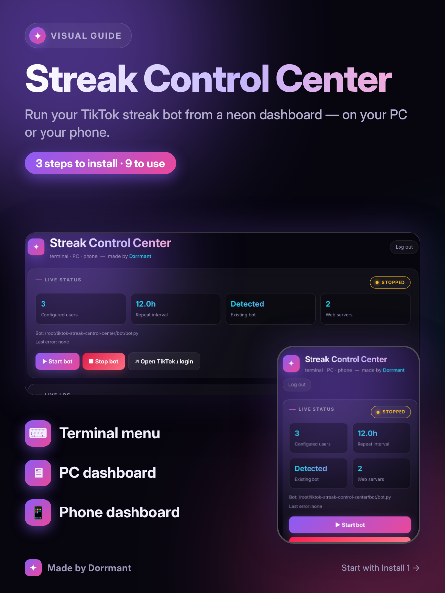

# ✦ Streak Control Center

**A neon control panel for a TikTok streak bot — terminal menu, PC dashboard and phone dashboard, all sharing one backend.**

Made by **Dorrmant** · MIT licensed

</div>

## Features

- **Three ways to control one bot:** an interactive terminal menu, a PC/LAN web dashboard (`:8765`) and a phone-friendly dashboard (`:8766`).
- **Live logs everywhere:** the terminal and both dashboards stream what the bot is doing, color-coded (errors, waits, successes).
- **Password-protected dashboards**, generated on first run.
- **Resilient navigation:** retries with back-off when TikTok answers with a `403`, and keeps the browser session alive between runs.
- Start / stop the bot, open TikTok to log in, and edit usernames, message and timings without touching files.

<div align="center">

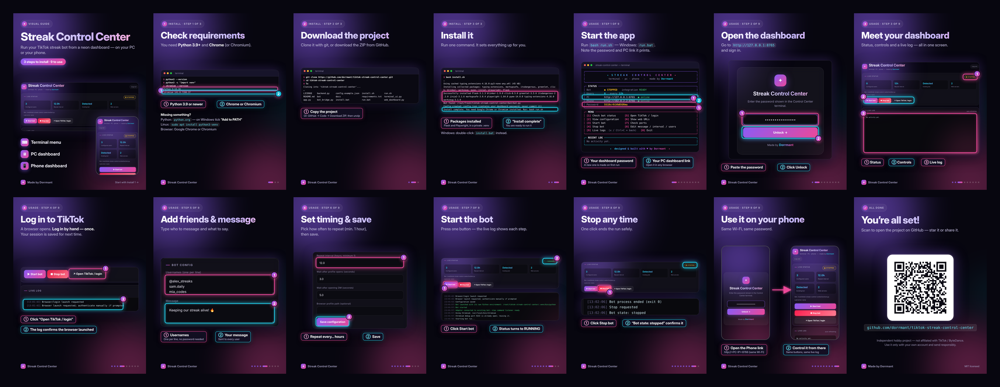

</div>

---

# 📦 Installation

Three steps (Install 1–3). Everything below was tested on a clean copy of the project.

<table>
<tr><td width="33%" align="center">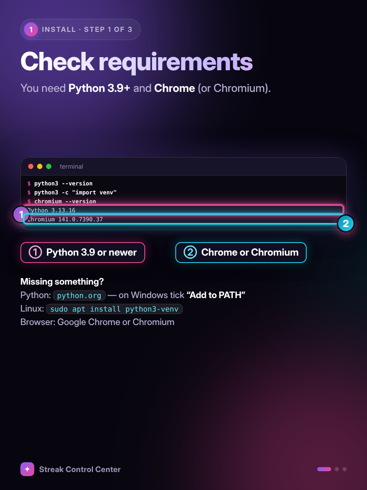</td><td width="33%" align="center">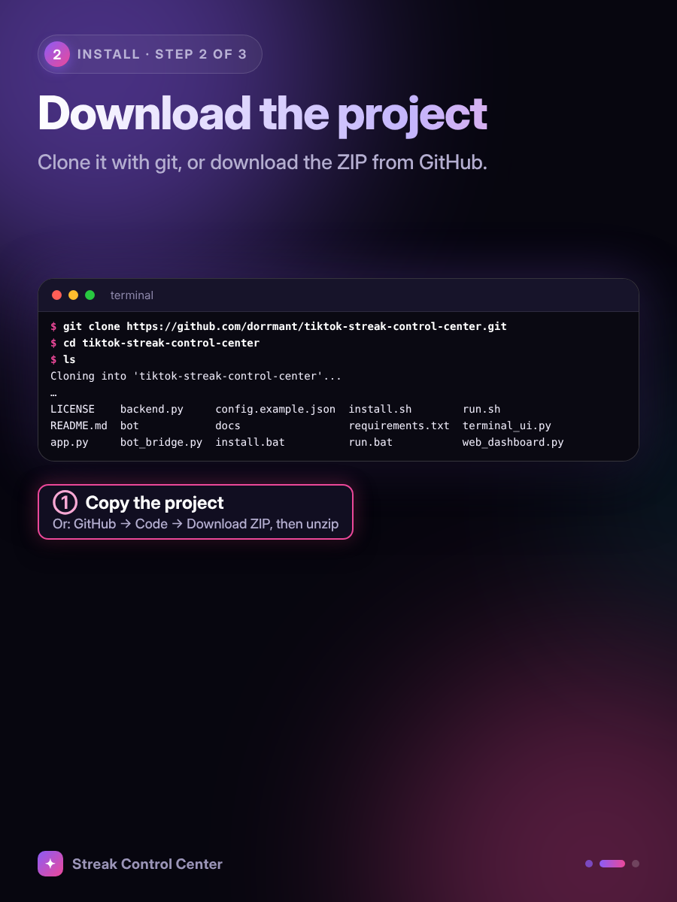</td><td width="33%" align="center">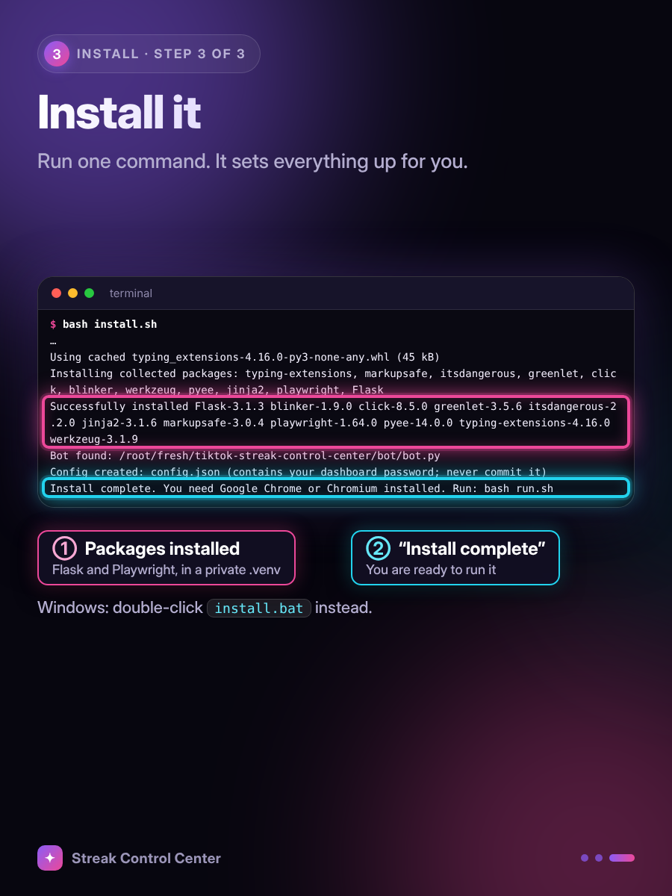</td></tr>
</table>

## Requirements

- **Linux** (tested on Linux Mint), **Windows 10/11** (added, lightly tested) and macOS (should work).
- Python 3.9+ (Linux: `sudo apt install python3-venv`; Windows: install from python.org and tick *Add to PATH*)
- Google Chrome or Chromium installed

## Install

**Windows:** download the ZIP from GitHub (Code → Download ZIP), unzip it, double-click **`install.bat`**, then **`run.bat`**. Use Windows Terminal or PowerShell for the best colors.

**Linux / macOS:**

```bash
git clone https://github.com/dorrmant/tiktok-streak-control-center.git
cd tiktok-streak-control-center
bash install.sh
bash run.sh
```

The first run creates `config.json` with a random dashboard password. It is shown in the terminal menu.

---

# 🚀 Usage

Nine steps (Usage 1–9) from first launch to your phone.

<table>
<tr><td width="33%" align="center">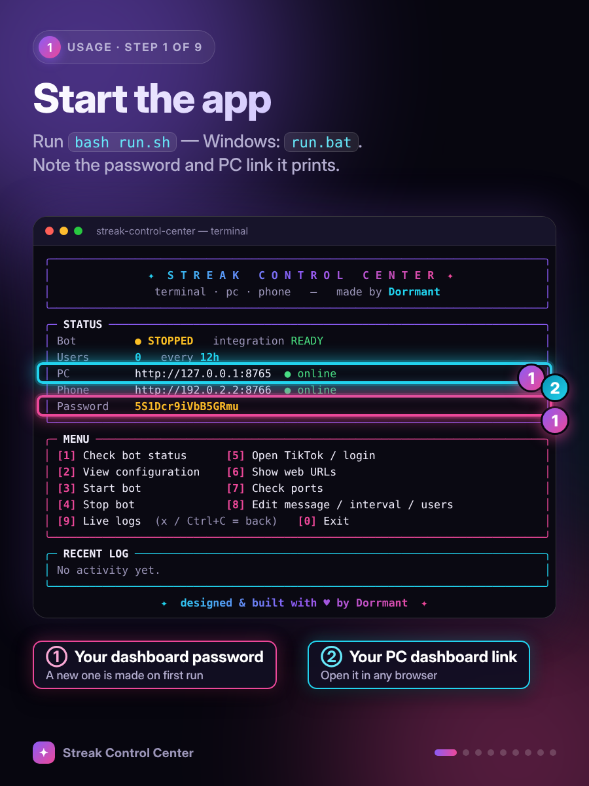</td><td width="33%" align="center">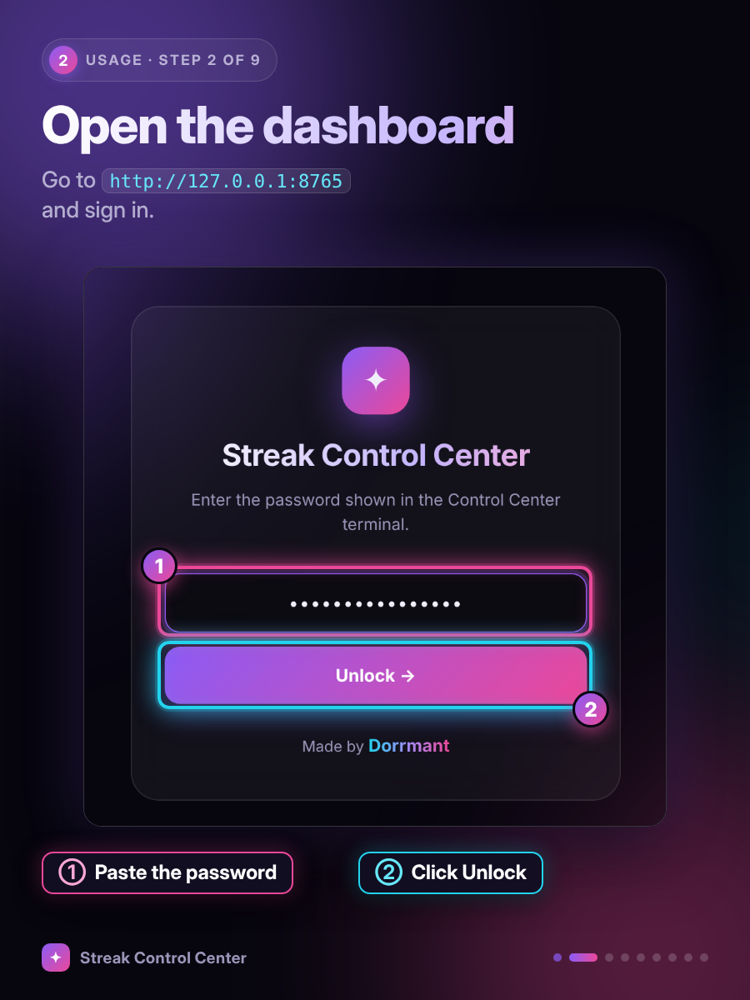</td><td width="33%" align="center">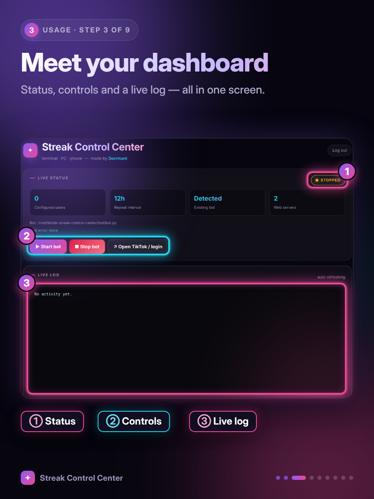</td></tr>
<tr><td width="33%" align="center">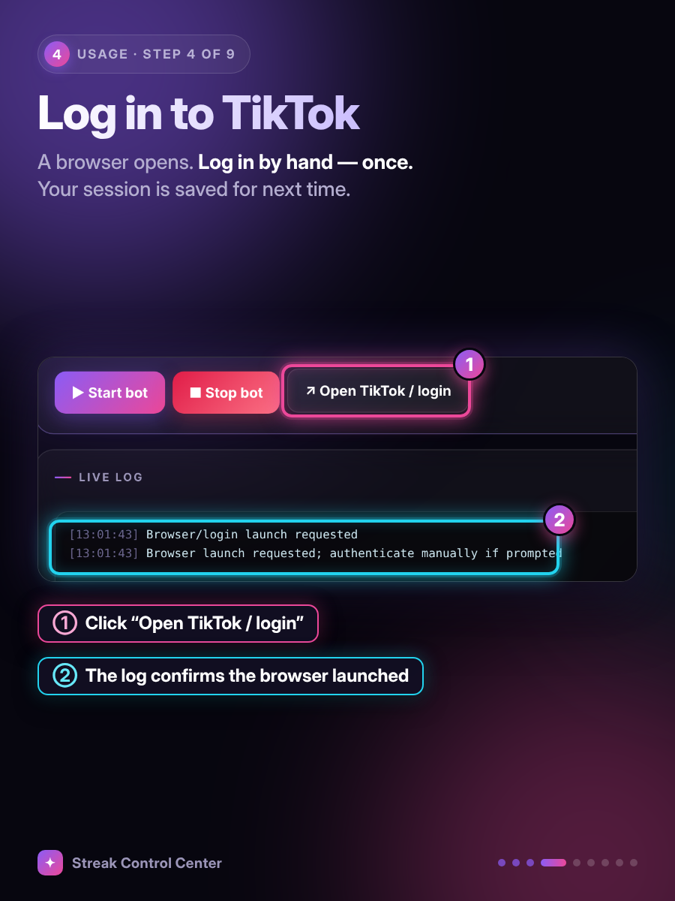</td><td width="33%" align="center">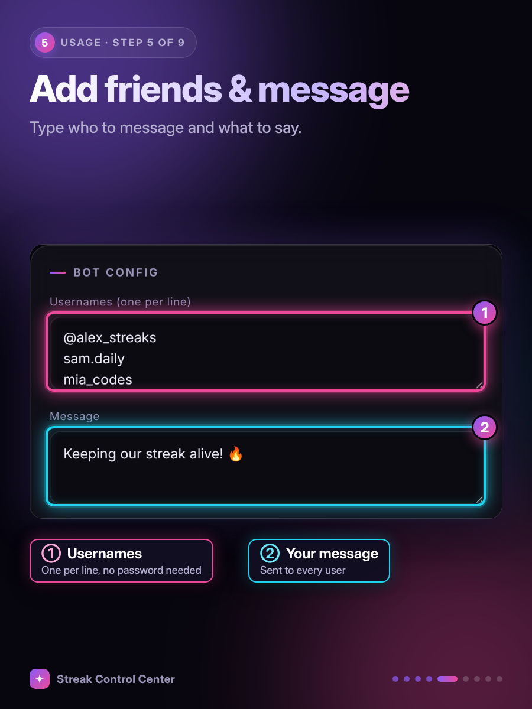</td><td width="33%" align="center">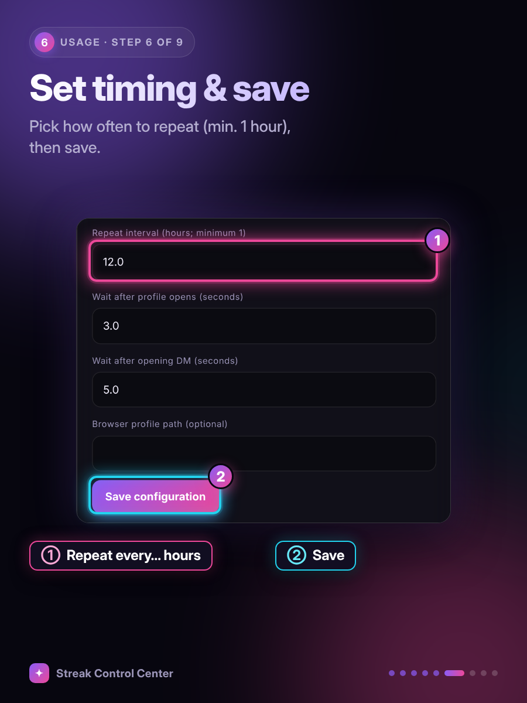</td></tr>
<tr><td width="33%" align="center">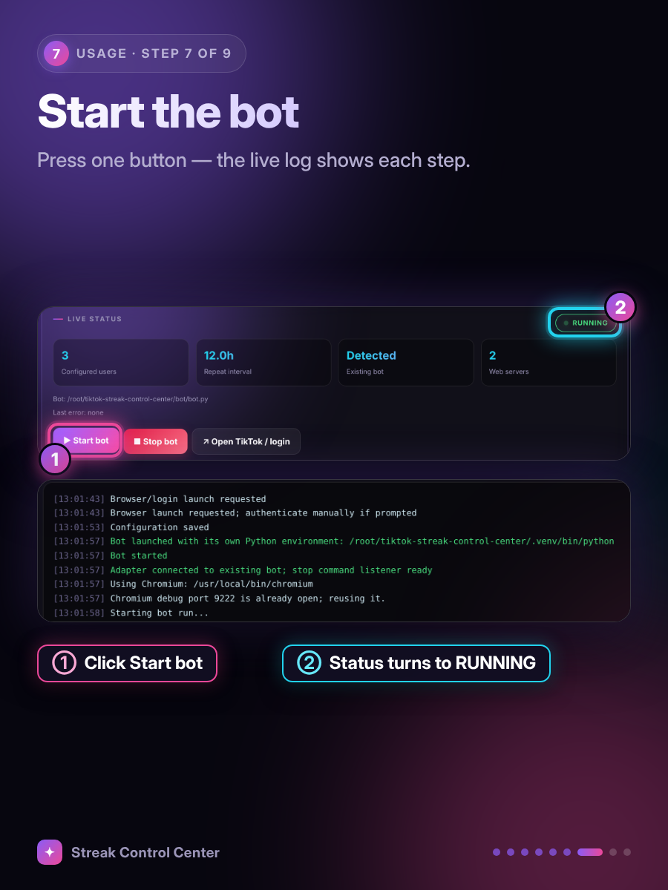</td><td width="33%" align="center">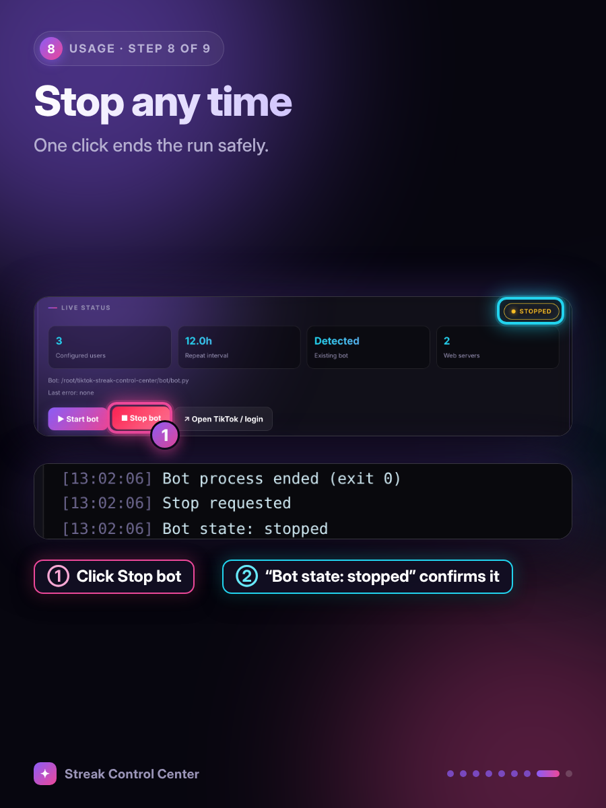</td><td width="33%" align="center">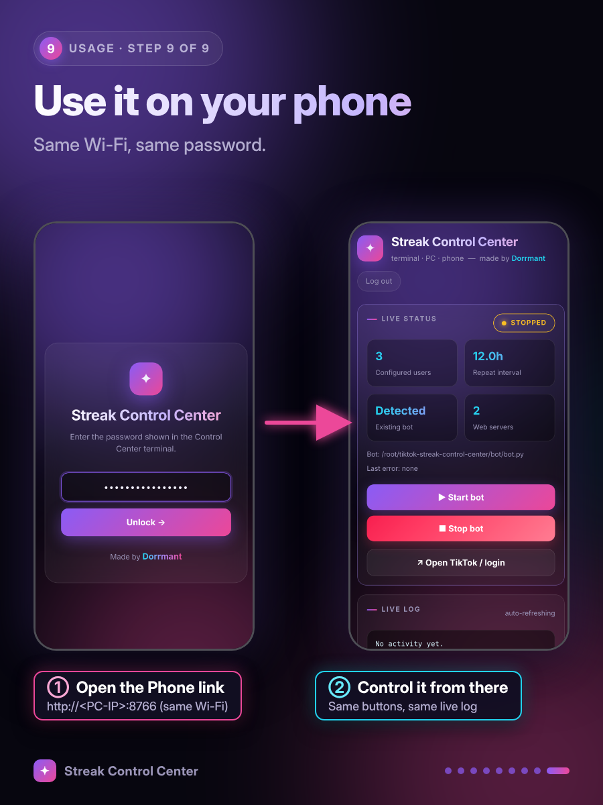</td></tr>
</table>

## In short

1. In the menu choose **5 · Open TikTok / login** and log in once by hand. The session is saved in a local browser profile.
2. Choose **8** (or use the web dashboard) to set your usernames, message and repeat interval.
3. Choose **3 · Start bot**. Watch progress in **9 · Live logs** or on the dashboard.
4. Open `http://127.0.0.1:8765` on your PC, or `http://<your-LAN-IP>:8766` on your phone (same Wi-Fi).

| Key | Action | Key | Action |
|---|---|---|---|
| 1 | Bot status | 6 | Show web URLs |
| 2 | View configuration | 7 | Check ports |
| 3 | Start bot | 8 | Edit message / interval / users |
| 4 | Stop bot | 9 | Live logs (`x` + Enter to go back) |
| 5 | Open TikTok / login | 0 | Exit |

---

## Configuration

Copy nothing by hand: `config.json` is created automatically. See [`config.example.json`](config.example.json) for the fields. `config.json` holds your dashboard password and is git-ignored — **never commit it.**

Want to use your own bot instead of the bundled one? Put its path in `bot_source`. It must expose `bot_worker(config, stop_event)` and `open_tiktok(config, wait_for_login=True)`.

## Troubleshooting

- **HTTP 403 / "Access denied" on profiles:** TikTok's anti-bot layer. Log in first (option 5), disable any VPN, raise "Profile-load wait" to 8–10 s, and avoid very short intervals. The bot retries automatically, but it cannot bypass a blocked IP.
- **"Could not connect to Chromium":** close other Chrome windows that use the bot profile, or check `debug_port` (default `9222`).
- **Phone can't open the dashboard:** use the LAN IP from the menu, and allow ports 8765/8766 in your firewall.

## Security

- Dashboards listen on your local network. **Do not port-forward them to the internet.**
- The bot never asks for or stores your TikTok password; you log in manually in the browser.

## Disclaimer

This is an independent hobby project, **not affiliated with or endorsed by TikTok / ByteDance**. Automating a TikTok account may violate TikTok's Terms of Service and can lead to rate limits or account restrictions. Use it only with your own account and with people who expect your messages, send responsibly, and at your own risk. The authors accept no liability.

## Contributing

Issues and pull requests are welcome. Please keep personal data (usernames, passwords, `config.json`) out of commits.

## License

[MIT](LICENSE) © 2026 Dorrmant

---


</div>
